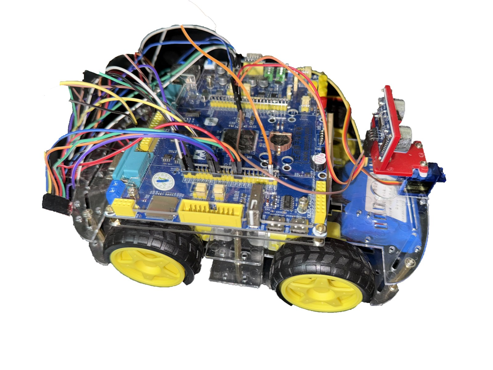
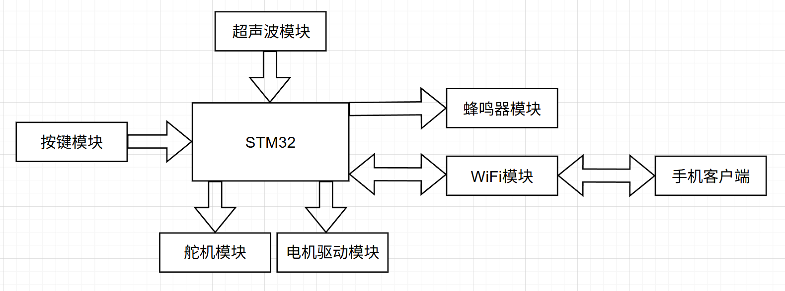
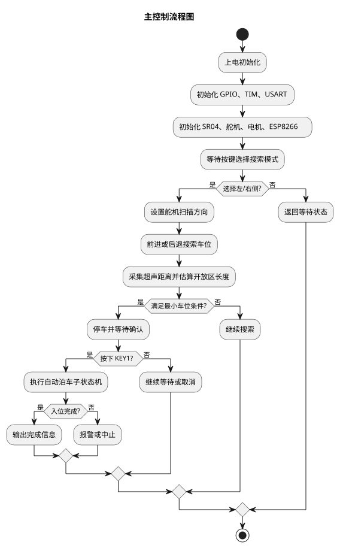
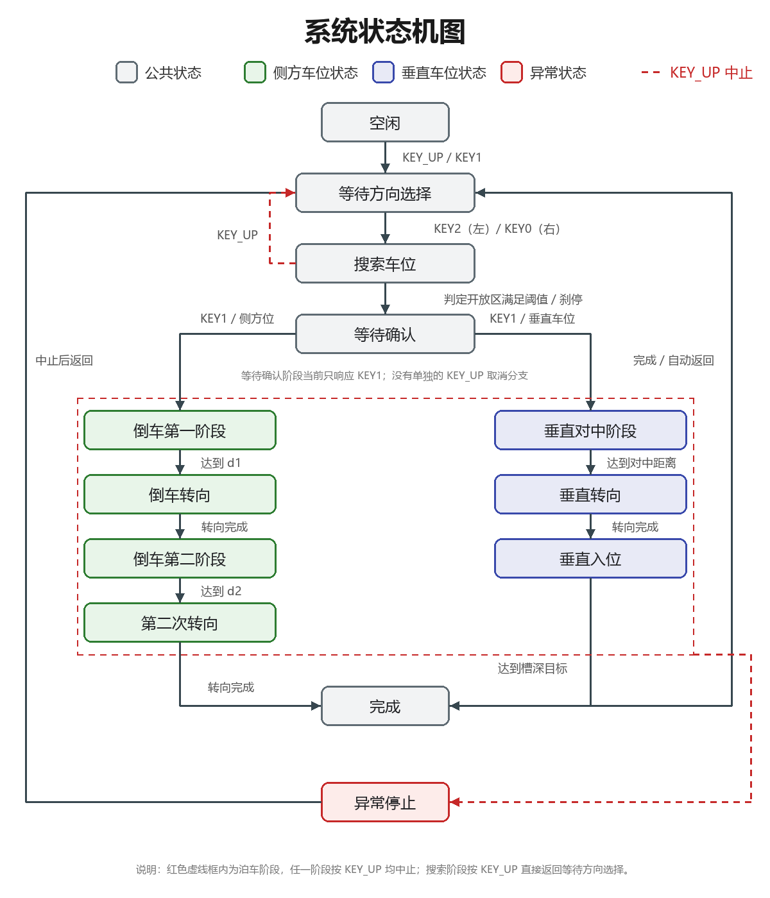
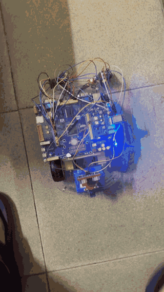
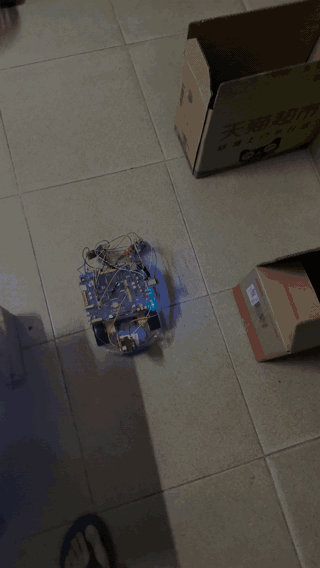

# STM32F407 智能小车自动泊车系统



基于**正点原子（ALIENTEK）探索者 STM32F407 开发板**的缩比智能车自动泊车原型。系统使用 SR04 超声波测距、SG90 舵机、TB6612 四轮电机驱动、按键和蜂鸣器完成“搜索车位—识别车位—人工确认—自动入位”的完整流程，并通过 `ATK-ESP8266` 将运行日志回传到手机端。

> 本仓库包含固件源码、算法文档、原理/架构图和演示视频，不包含论文、答辩 PPT 及第三方开发资料。

## 主要功能

- 按键选择左侧或右侧搜索方向
- 前进或后退搜索侧方/垂直车位
- 根据侧向超声距离和开放区持续时间估算车位开口长度与槽深
- 区分侧方位车位与垂直车位，侧方位优先
- 发现车位后停车，等待人工确认
- 侧方位：两段直行 + 两次原地自转完成入位
- 垂直车位：对中 + 一次原地自转 + 直线入位
- 通过 ESP8266 AP + TCP 将串口日志同步到手机
- 支持左右车位镜像、前往后/后往前两种寻位方向

## 硬件组成

| 模块 | 型号/说明 |
|---|---|
| 主控 | **正点原子（ALIENTEK）探索者 STM32F407 开发板**（STM32F407ZGT6） |
| 电机驱动 | TB6612 |
| 电机 | 四轮 TT130 直流减速电机 |
| 舵机 | SG90 |
| 超声模块 | SR04 |
| Wi-Fi 模块 | ATK-ESP8266（USART3，PB10/PB11） |
| 板载蜂鸣器 | PF8（默认关闭） |
| 按键 | KEY0 / KEY1 / KEY2 / KEY_UP |

### 适用开发板

本项目以**正点原子探索者 STM32F407 开发板**（ALIENTEK Explorer STM32F407）为硬件平台，工程中的 GPIO、TIM、USART 配置与该板卡对应。使用其他 STM32F407 板卡时，需要按 [bishe.ioc](firmware/bishe.ioc) 和原理图调整引脚；使用正点原子探索者板卡的用户可以直接参考本仓库的接线与 Keil 工程。

## 项目结构

```text
.
├─ firmware/
│  ├─ Core/                 # 应用层与板级初始化
│  │  ├─ Inc/
│  │  └─ Src/
│  ├─ Drivers/              # STM32F4 HAL 与 CMSIS
│  ├─ MDK-ARM/              # Keil 工程与启动文件
│  └─ bishe.ioc             # STM32CubeMX 配置
├─ docs/
│  ├─ 倒车算法实施.md
│  ├─ 搜寻车位算法.md
│  ├─ ESP8266手机串口信息传输文档.md
│  ├─ 模式参数对照表.md
│  ├─ images/               # 架构图、流程图、电路图、实物图、GIF 预览
│  └─ videos/               # 演示视频 MP4
└─ README.md
```

核心文件：

- [main.c](firmware/Core/Src/main.c)：主状态机、车位判定和泊车子状态机
- [motor.c](firmware/Core/Src/motor.c)：TB6612 四轮电机驱动
- [servo.c](firmware/Core/Src/servo.c)：舵机角度控制
- [sr04.c](firmware/Core/Src/sr04.c)：SR04 超声测距
- [key.c](firmware/Core/Src/key.c)：按键扫描
- [esp8266.c](firmware/Core/Src/esp8266.c)：ESP8266 初始化、建链与日志发送

## 系统设计



主控制流程：



软件状态机：



更多图示见 [docs/images](docs/images)。

## 演示视频

### 侧方位停车

[](docs/videos/parallel-parking.mp4)

### 垂直停车

[](docs/videos/vertical-parking.mp4)

> 说明：演示视频为手机手持拍摄，包含手机端日志画面；为减小仓库体积，视频已去除音频和拍摄元数据（含定位信息）。GitHub README 对 MP4 内嵌播放支持不稳定，因此用 GIF 做页面预览，点击 GIF 可打开完整 MP4。

## 工作原理

### 1. 搜索车位

小车按用户选择的方向，以固定低速前进或后退，舵机带动超声波模块朝目标侧扫描。当侧向净距明显变大时，程序认为进入“开放区”；当距离重新缩小，开放区结束。开放区持续时间乘以线速度，用于估算车位开口长度；开放区内的最大侧向距离作为车位深度。

### 2. 车位判定

采用“宽度阈值 + 时间积分 + 类型优先级”的方式：

1. 读取原始超声距离 `d_raw`
2. 计算侧向净距 `d_side = d_raw - 9`
3. 当 `d_side > 22 cm` 时开始记录开放区，并持续更新最大深度
4. 当 `d_side <= 22 cm` 时结束记录
5. 用 `L_open = 18.46 × t_open` 估算开口长度
6. 若 `L_open >= 37 cm`，判为侧方位车位
7. 否则若 `L_open >= 22 cm` 且 `L_depth >= 40 cm`，判为垂直车位
8. 否则继续搜索

垂直车位只在开口长度未达到 37 cm 时才会被采用；同一开放区同时满足两类条件时，侧方位优先。

### 3. 自动泊车

当前采用时间积分式开环控制，无编码器闭环：

- 侧方位、倒车入位：`d1 = 4 × L_open / 5`，第一次自转 `1301 ms`，`d2 = 1.1 × raw_at_stop`，第二次自转 `1544 ms`
- 侧方位、前进入位：`d1 = L_open / 2`，第一次自转 `1464 ms`，`d2 = 1.1 × raw_at_stop`，第二次自转 `1563 ms`
- 垂直、倒车入位：`d1 = 9 × L_open / 10`，自转 `1303 ms`，`d2 = L_depth − 6 cm`
- 垂直、前进入位：`d1 = 3 × L_open / 4`，自转 `1765 ms`，`d2 = min(L_depth − 18 cm, 40 cm)`

左右转向：

- 侧方位倒车入位：左侧车位先右转再左转，右侧车位先左转再右转
- 侧方位前进入位：左侧车位先左转再右转，右侧车位先右转再左转
- 垂直车位只有一次自转：倒车入位左侧右转、右侧左转；前进入位方向相反

## 关键参数

| 参数 | 数值 |
|---|---:|
| 车长 | `31.0 cm` |
| 车宽 | `17.0 cm` |
| 搜索速度 | `10%` |
| 泊车直行速度 | `10%` |
| 自转速度 | `15%` |
| 线速度标定 | `18.46 cm/s` |
| 超声侧向偏移 | `9.0 cm` |
| 侧向开放区阈值 | `22.0 cm` |
| 侧方位长度余量 | `6.0 cm` |
| 最小侧方位长度 | `37.0 cm` |
| 垂直车位最小开口 | `22.0 cm` |
| 垂直车位最小槽深 | `40.0 cm` |
| 侧方位时间阈值 | 约 `2.004 s` |
| 平行倒车第一次自转 | `1301 ms` |
| 平行倒车第二次自转 | `1544 ms` |

完整的前往后/后往前、侧方位/垂直参数对照见 [模式参数对照表](docs/模式参数对照表.md)。

## 按键说明

| 按键 | 功能 |
|---|---|
| `KEY_UP` | 进入方向选择模式；搜索或泊车时按下可中断并返回 |
| `KEY2` | 选择左侧搜索并开始寻位 |
| `KEY0` | 选择右侧搜索并开始寻位 |
| `KEY1` | 发现车位后确认开始自动泊车；在待机阶段用于选择“前往后 + 前进入位” |

等待确认阶段当前只响应 `KEY1`；如需取消，可先进入泊车后按 `KEY_UP` 中止，或复位。

## 串口与手机日志

- `USART1`：板载 CH340，连接电脑串口调试，`115200 8N1`
- `USART3`：连接 ATK-ESP8266，将日志转发到手机

手机端使用步骤：

1. 将 ATK-ESP8266 连接到开发板 `USART3`（`PB10/PB11`）并正常供电
2. 手机连接热点 `ATK-ESP8266`
3. 手机网络调试助手选择 `TCP Client`
4. 连接 `192.168.4.1:8086`
5. 关闭 `HEX` 显示，即可看到中文文本日志

详细接线和 AT 指令配置见 [ESP8266 手机串口信息传输文档](docs/ESP8266手机串口信息传输文档.md)。

## 编译与烧录

建议环境：

- Keil MDK-ARM 5.x
- ArmClang 6.x
- STM32F4xx DFP 设备支持包

步骤：

1. 用 Keil 打开 [bishe.uvprojx](firmware/MDK-ARM/bishe.uvprojx)
2. 选择目标 `bishe`
3. 编译工程
4. 连接 ST-Link 下载到开发板
5. 打开 USART1 串口观察日志并实车调试

## 文档

- [倒车算法实施](docs/倒车算法实施.md)
- [搜寻车位算法](docs/搜寻车位算法.md)
- [ESP8266 手机串口信息传输](docs/ESP8266手机串口信息传输文档.md)
- [模式参数对照表](docs/模式参数对照表.md)

## 已知限制

- 采用开环时间积分，没有编码器里程闭环
- 没有 IMU/陀螺仪，转向角度依赖时间标定
- 实车效果受地面摩擦、供电电压、电机一致性和车体负载影响
- 垂直车位前进入位参数仍在继续标定

后续可优先增加编码器闭环、IMU 角度闭环、车尾测距确认和多传感器融合。

## 第三方组件与许可

`firmware/Drivers/CMSIS` 与 `firmware/Drivers/STM32F4xx_HAL_Driver` 来自 STMicroelectronics，遵循其原始许可证，详见对应目录下的 `LICENSE.txt` / `License.md`。
